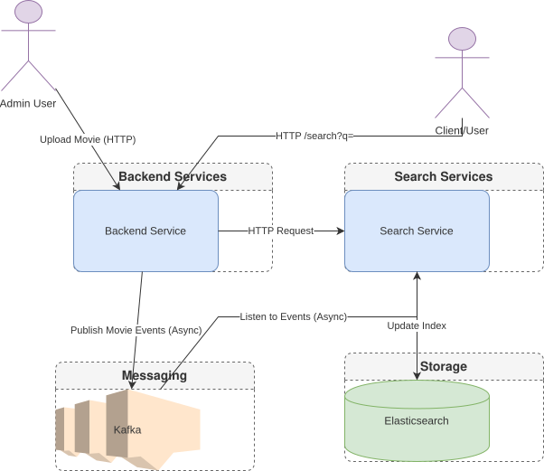

# Netflix Video Streaming Platform (Microservices Architecture)

A production-grade, event-driven video streaming platform built with **Spring Boot**, **React (Vite)**, **AWS S3/CloudFront**, **Apache Kafka**, **Elasticsearch**, **Kubernetes**, and **Terraform**. Designed for adaptive bitrate HLS video playback, premium subscription gating, and scalable microservices search indexing.

---

# Application Architecture

<p align="center">
  
</p>

This architecture focuses on the search flow and event-driven communication:
1. **Client** sends `/search?q=` request to **Backend**.
2. **Backend** communicates with **Search Service**.
3. **Search Service** retrieves data from **Elasticsearch**.
4. **Admin uploads** trigger **Kafka events**.
5. **Search Service** consumes **Kafka events** and updates **Elasticsearch**.

> *Note: Login and Signup functionality operates normally but is not included in this diagram.*

---

# Application Video

[View Project Architecture / Demo](https://drive.google.com/file/d/1IgScqm_wyGXaEg7SjNqAQi5ACEuxN8r7/view?usp=sharing)

---

## 🎬 End-to-End Media Delivery Architecture

```text
[ React / Vite Frontend ]
        │
        ├── Header: Authorization Bearer <JWT> or Cookie
        ▼
[ Spring Boot Backend ] ──── (Dual Authentication: JwtAuthenticationFilter)
        │                                         │
        ├── Razorpay Payment Webhooks             ├── Event Publisher
        ▼                                         ▼
[ DB: subscriptionStatus = ACTIVE ]       [ Apache Kafka ]
        │                                         │
        ├── Serves Signed / Proxied HLS          ├── Sync Search Index
        ▼                                         ▼
[ AWS CloudFront CDN (OAC) ] <─────────── [ Elasticsearch Engine ]
        │
        ▼
[ AWS S3 Media Bucket ] (.m3u8 playlists & .ts segments)
```

---

## 🛠️ Tech Stack

* **Backend:** Java 17, Spring Boot, Spring Security (RBAC), Spring Cloud Gateway, JPA/Hibernate, RESTful APIs, JWT authentication, FFmpeg HLS transcoding
* **Frontend:** React, Vite, TypeScript, Video.js (VHS), Tailwind CSS v4, Lucide Icons
* **Databases & Search:** MongoDB Atlas, PostgreSQL, Elasticsearch, Redis
* **Messaging & Events:** Apache Kafka, AKHQ
* **Cloud & DevOps:** AWS (S3, CloudFront OAC, IAM), Terraform, Docker, Kubernetes (K8s), Helm
* **Monitoring & Tooling:** Kibana, Glances, Dozzle, Homer Dashboard

---

## 🚀 Key Features

### 1. Adaptive Bitrate (ABR) HLS Streaming
* Transcodes raw video uploads into **HLS (HTTP Live Streaming)** master playlists (`master.m3u8`) and multi-resolution variants (`1080p`, `720p`, `480p`, `360p`).
* Serves video segments directly via **AWS CloudFront CDN** backed by Origin Access Control (OAC) and dynamic CORS preflight policies.

### 2. Tiered Access Control & Token Security
* Custom `JwtAuthenticationFilter` cross-verifies stateless JWT payload claims (`isPremium`) and live database status (`subscriptionStatus: ACTIVE`).
* Custom Video.js `beforeRequest` interceptor automatically attaches Bearer tokens to streaming requests while supporting fallback cookie authorization.

### 3. Integrated Payments & Instant Upgrades
* Integrated **Razorpay Checkout API** for automated subscription handling.
* Payment verification webhooks immediately update user entitlements and grant `ROLE_PREMIUM` access across active sessions.

### 4. High-Performance Search Engine
* Asynchronous data sync pipeline offloads catalog data into **Elasticsearch** via Kafka event streams.
* Achieves sub-20ms query latency across multi-attribute full-text search datasets.

---

## ☁️ Infrastructure & Cloud Provisioning

Infrastructure is defined as code using **Terraform** under `terraform/`:

* **AWS S3:** Private bucket storage for master playlists (`.m3u8`) and `.ts` media chunks.
* **AWS CloudFront:** CDN distribution configured with:
  * Origin Access Control (OAC) allowing read access exclusively to CloudFront distribution ARNs.
  * `Managed-CORS-With-Preflight` Response Headers Policy to allow secure cross-origin streaming.
  * `Managed-CachingOptimized` Cache Policy for edge segment delivery.

---

## 💻 Local Development & Deployment

### Prerequisites
* Java 17+ & Maven 3.8+
* Node.js 18+ & npm
* Docker Desktop & Kubernetes (`kubectl`, `helm`)
* Terraform CLI (1.3+)

### 1. Clone the Repository
```bash
git clone https://github.com/DipuKumar1997/netflix-video-streaming.git
cd netflix-video-streaming
```

### 2. Cloud Infrastructure Provisioning
```bash
cd terraform
terraform init
terraform apply -auto-approve
```

### 3. Backend Setup
```bash
cd ../backend-service
mvn clean package -DskipTests
docker build -t netflix-backend:latest .
```

### 4. Kubernetes / Helm Deployment
```bash
cd ../helm
helm upgrade --install netflix-platform ./netflix-chart
```

### 5. Frontend Setup
```bash
cd ../frontend-service
npm install
npm run dev
```

---

## 📊 Dashboards & Monitoring Access

| Service | URL (Local Example) | Description |
| :--- | :--- | :--- |
| **Homer Dashboard** | `http://localhost:8001` | Central dashboard for all running services |
| **Glances** | `http://localhost:61208` | Real-time system and Docker monitoring |
| **Dozzle** | `http://localhost:8888` | Live Docker container logs |
| **AKHQ** | `http://localhost:8081` | Kafka topic and consumer management |
| **Kibana** | `http://localhost:5601` | Elasticsearch data visualization |

---

## 👤 Author

**Dipu Kumar**  
*B.Tech in Computer Science & Engineering, NIT Mizoram*  
* **GitHub:** [github.com/DipuKumar1997](https://github.com/DipuKumar1997)  
* **LinkedIn:** [linkedin.com/in/dipu-kumar-450026334](https://linkedin.com/in/dipu-kumar-450026334)
